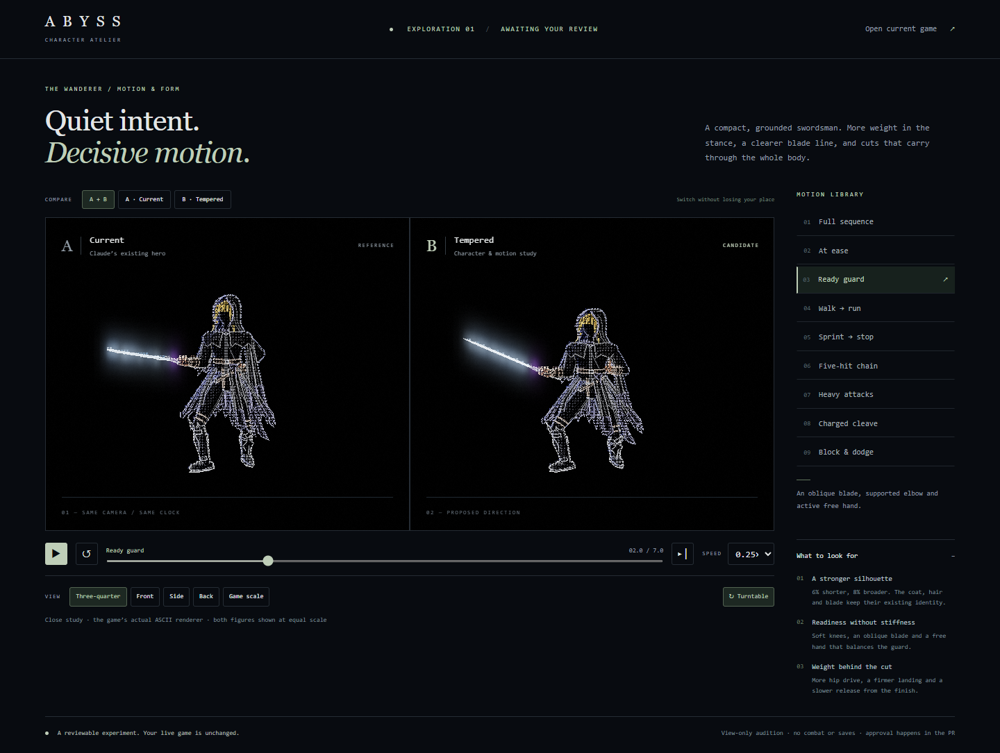
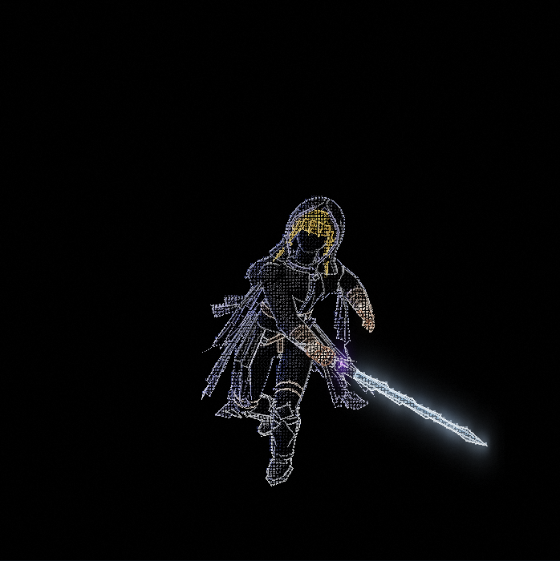
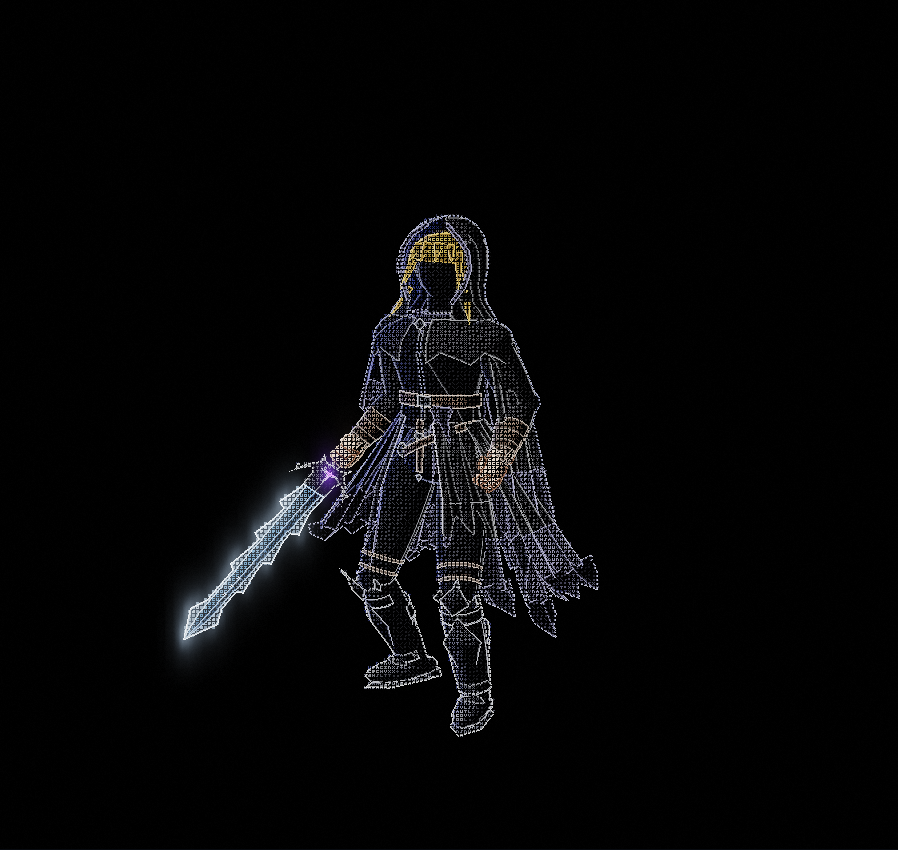
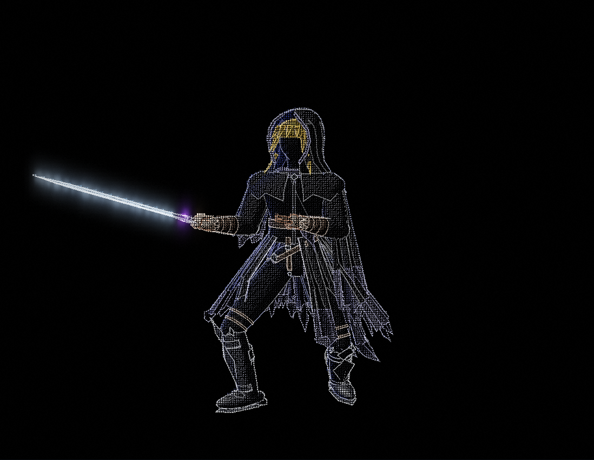

# The Wanderer: Tempered (unapproved visual study)

**Status:** Tempered v4, draft experiment. The owner likes the look and supplied a motion reference
to refine the light-combo free hand and normal-to-heavy transition. These are revised for review.
Do not merge or adopt without the owner's
choice. The motion studio and the playable preview are separate pages; the regular game is unchanged.

Open `/hero-study.html` on this PR's Vercel preview, or run `npm run dev` and open
`http://localhost:5173/hero-study.html`. For actual play, open
`/hero-play.html?level=ash&hero=tempered` (or `hero=current`). The normal `/` URL is the existing game.

## Play it in the game

The owner requested an in-game preview after the side-by-side film. `/hero-play.html` boots the
actual game and decorates only that page's player instance. Choose **Explore / reset** or **Fight
boss**, then switch **A · Current / B · Tempered** during the same fight. The level selector offers
Cinderwood, Ashfall and the Obsidian Throne. **Closer camera** helps inspect the character at the
normal gameplay angle. **Invulnerable** starts on and can be switched off. On narrow screens, tap
the collapsed preview panel to open the controls; the normal touch / controller inputs still work.
Choose an **IDLE** gesture and **Play idle gesture** to reset to exploration and replay that exact
motion. Moving or attacking interrupts it normally. This avoids waiting for random idle choices.
For v4, tap a light, then Heavy during that attack to branch; repeat after two, three or four
lights. The motion studio's **Buffered light combo** and **Normal → heavy** let the owner pause,
slow and scrub those same transition windows from different angles.

The playable page replaces its own localStorage and sessionStorage with empty memory stores
**before** importing the game. It does not read or write the browser's existing stores. Reloading
discards settings and telemetry from the preview. It includes no analytics script.

The adapter reuses the studio's exact pose functions. Its draw transform is removed during IK and
inverted by `unlean` before SwordSweep uses blade points; `leanPoint` applies the matching forward
transform. Switching resets sweep history so the different silhouettes cannot produce a phantom
hit between them. It preserves player position, health, action clocks and boss state. Equipment
rebuilds get their own candidate pose map. Shared prototypes, bosses and combat tuning are unchanged.
The opening heavy uses a private definition with diagonal-cut choreography, sweep contact feedback
and an edge glint. Its damage, travel and phase times stay unchanged. Switching to Current restores
the original thrust definition, including during a live attack.

This is a playable experiment, not final gameplay approval: the pose edits change the blade path.
Complete reach / outfit / alternate-move calibration and human feel review remain for adoption.

## Direction

Keep the Wanderer's identity and Claude's ink-line ASCII renderer, equipment, rig, IK, planted-foot
planner and spring-driven cloth. Make the silhouette more compact, the ready pose more deliberate,
and the cut feel carried by the hips and chest. The owner can reject the whole study without changing
the game. Claude's independent three-style draft [PR #56](https://github.com/eshin087/gcdAbyss/pull/56)
is untouched; this is an additional option, based on main `46e2c989` (PR #57).

| Element | Current reference | Tempered candidate |
| --- | --- | --- |
| Presentation proportions | 1:1 | width 1.08, height 0.94, depth 1.04 |
| Rest / readiness | approved at-ease / fencer poses | 3.5 cm lower centre, 3.5 cm wider foot target on each side |
| Free hand at ease | resting on the belt | loose beside the thigh, wrist aligned with the forearm |
| Ready blade | near-horizontal point | oblique line, roughly 28° to the sword side / 22° up before wrist constraints; straighter grip |
| Free hand in guard | on belt | relaxed open hand in front of the chest, wrist aligned with the forearm |
| Walk / run | existing speed-matched stride | same feet, lower centre, quieter bounce, counterbalanced shoulders and relaxed free hand |
| Cuts | existing keyframed clips | hip/chest accents, eased gather, faster middle cut, controlled recovery and free-arm counterbalance |
| Opening heavy | dashing thrust | dashing diagonal slash, with sweep contact and edge glint |
| Six idle gestures | original body/hand targets | new look, shoulder loosen, edge check, low flourish, forward lift and weight shift |
| Held charge | high-frequency shake | small, slow held breath; existing release and combat timing |
| Roll, hair, cloth | existing animation / springs | retained, with the candidate's presentation proportions |

The scale is a **drawing transform**, removed while IK and cloth solve. It compresses the entire
rendered actor, including its weapon. It is not a new anatomically re-authored skeleton. All data in
`heroDims.js`, `swings.js`, `combat.js`, and every existing game source file is unchanged.

## Review

- A + B uses the same camera, lighting, renderer, phase and root path. Neither actor is normalized
  to the other's height. A / B solo buttons switch without resetting time and are useful on phones.
  Narrow phones open on the candidate alone; A + B remains one tap away.
- Full sequence: rest → guard → walk → run → sprint → combo → block → charge → cleave → dodge.
- Eleven motion selections (including buffered lights, heavy transitions and all six forced idles), five camera angles including the actual 58° / 36 m game scale,
  turntable, 0.25× / 0.5× / 1×, pause, one-frame advance, and deterministic timeline scrubbing.
- Both actors get the same original combat timing and default variant. This pilot is a controlled
  audition: its chained selections use the earliest recovery cutoff from `def.chain`, but it does
  not simulate input, targets, impacts or real combat. Validate those in the playable page.
- Reduced-motion preference starts paused. Nothing is saved, and no game flow, audio engine,
  analytics, localStorage, network data or player settings are instantiated by the study.

### V4: reference-led free-hand flow and heavy transitions

The owner's supplied clip shows a loose free hand, a soft elbow and a smaller counterbalance driven
by the torso. V4 interprets those qualities in the existing rig and combat timing. It is hand-authored
procedural motion, not a motion-capture extraction or a frame-for-frame copy of the reference.

Every light variant now has a compact gather and opening arc, with relaxed fingers. The wrist
clasp and high-back finger points no longer pull the left arm across the torso and throw it out
again between hits. Attack entries carry the **solved** endpoint: the previous `lH` target can be
unused under a two-handed grip or wrist contact. Local bone transforms keep this independent of
the drawing scale and camera lean. Recovery returns directly to the candidate stance.

For two-handed attacks, the supporting hand gathers before closing on the hilt between 16% and
86% of the windup; an already joined hand stays joined. Falling windups gain 10 cm of forward
clearance, fading out before the active phase. The cutting paths, damage and gameplay phase times
are preserved. Current bypasses the candidate pose and hand changes.

The old studio combo let each swing recover completely. V4 uses the game's actual chain cutoff
(30% of recovery for the ordinary lights), and Normal → heavy includes rest-to-heavy plus all four
light-chain branches. In a matched default-chain diagnostic at 120 Hz, peak left-hand speed during
the first 50 ms of each entry fell from **17.64 to 4.21 m/s**. Across every adjacent light-variant pair and four
branches at 30/60/120 Hz, 11,728 attack frames pass with no free-wrist limit contacts; the widest
sampled supporting-grip gap is 4.7 cm. These are focused continuity checks, not owner approval.

### V3: full idle replacement and a heavy slash

V2 changed the fighting guard but left the relaxed stance's belt hand and the original six idle
gestures underneath. V3 explicitly replaces that entire idle layer. The free arm hangs below the
belt by the thigh, with open fingers following the forearm. Look and shoulder motions keep that
loose arm; the edge check lifts it forward. The old full wrist circle, blade behind the shoulder
and pommel lean become a controlled low flourish, forward blade lift and weight shift. Original
random timing and movement/attack cancellation remain.

Sweeping Gale replaces the opening heavy's poke with the existing two-handed diagonal falling cut,
carried by the same dash. The other four heavy branches already cut and remain distinct. The
private definition preserves damage, poise, travel and timings; slash feedback replaces point
feedback. The drawn blade travels 2.04 m laterally through this heavy's active phase, versus 0.21 m
for Current in the same controlled sample. Current restores the exact original definition.

All six complete idle envelopes were checked at 30/60/120 Hz: 5,181 frames with no free-wrist clamp,
neutral free wrists, and a maximum sword/forearm angle of 28°. Thirty-two before/after captures
cover both sides of the idles and the heavy's windup, cut and finish. The playable preview checks
each replay button, attack interruption and the new heavy's actual boss contact. This supplements
visual review; it is not a claim that every combat pose is anatomically final.

### V2 hand and motion refinement

The v1 guard held the free wrist against its original angle limit throughout the sampled guard.
V2 brings that hand forward, lowers the blade slightly and guides the sword elbow when the wrist
would fold hard. Free-hand targets are bounded in forearm space and still settle through the
original spring. Running fingers follow the forearm more closely. Supporting fists, wrist links,
braced palms and ground contacts retain the original solver.

Attack windups gather slightly longer, accelerate through the middle of the cut, then settle into
guard. The off hand gathers before a cut and counterbalances its finish. High windups gain a little
elbow space. Full charge uses a small slow breath instead of rapid vibration. The studio's charged
cleave selection includes a continuous held portion, without restarting the gather.

At 120 Hz in the standard studio sequences, the v1-to-v2 guard diagnostic changed from 100% of
frames hitting the free-wrist limit to 0%. Standard combo peak sword/forearm bend changed from
about 128° to 79°, and the standard heavy sequence from 128° to 81°. These are sequence-specific
measurements: some alternate moves still approach the original 128° safety limit. They do not
replace visual review or establish an anatomical limit.

The v1 image above and [v1 playable deployment](https://gcdabyss-4gu8z054o-eshin087s-projects.vercel.app/hero-play.html?level=ash&hero=tempered)
are preserved for comparison. [V2 is also preserved](https://gcdabyss-dvvzg2uhr-eshin087s-projects.vercel.app/hero-play.html?level=ash&hero=tempered).
The [v3 preview is preserved](https://gcdabyss-drswtrwuj-eshin087s-projects.vercel.app/hero-play.html?level=ash&hero=tempered).
The current pages are labeled v4.

## Isolation and verification

Only `hero-study.html` and `hero-play.html` import `src/dev/heroStudy/`. `scripts/build.mjs` emits separate
bundled pages. It adds no import or branch to the normal game. The build of `dist/index.html` using the
original build script from `46e2c989` and the experimental build script matched byte-for-byte:
SHA-256 `77146f1462407f64105582ca05e9eb0674b603cd3e8553f0f1c91eeb3355c342`.

`npm run test:hero-study`: 6,601 paired frames across eleven sequences check finite poses and rig
matrices, the blade's floor clearance, synchronized root travel, repeatable seeking, private
materials / pose maps, unchanged shared definitions, and removal of presentation scale for IK.
This check is also appended to `npm test`. The playable adapter additionally checks real blade
points at 36 headings / leans, inverse / forward transforms, exact pose-map restoration, equipment
rebuilds, sweep reset and storage isolation (including failure before game boot if isolation fails).
V2 adds 6,675 frames covering 21 attack variants at 30 / 60 / 120 Hz: finite poses, hand-to-sword
attachment, visible supporting grip, blade floor clearance, relaxed ready wrist and exact original
arm/wrist results with the hooks bypassed. The widest sampled supporting-hand gap in v3 is 4.9 cm;
full outfit / weapon contact fitting remains for adoption.

The existing full integration suite (`npm test`), glyph and changelog checks, and `npm run build`
pass locally. The focused hand checks are included in the same test command.

Browser checks use real headless Edge / WebGL: front, side, back, three-quarter and game angles;
13 sampled pose captures; playback, slow motion, pause, single-frame advance and scrub controls;
390×844 portrait and 852×393 landscape layouts. No browser errors on the study. Desktop and phone
screenshots are review evidence, not owner approval. A physical phone and human combat feel have
not been validated. Playable browser checks cover both variants' idle, run, attack, full charge,
charged release and dodge in all
three levels, live A/B health / position preservation, level navigation, camera and invulnerability
controls, 390×844 layout, and native-storage sentinel preservation. A separate normal animation-loop
check uses actual keyboard / mouse input: both variants land five guarded cuts on the Ash Disciple.
No browser errors. The normal-game HTML hash still matches the base above.

## Handoff for Claude after the owner's choice

The changes are self-contained in `src/dev/heroStudy/` and the two HTML preview entries. `actor.js`
owns the shared candidate poses; `gameplayActor.js` adapts the real player on the playable page.
`hands.js` owns the instance-only elbow / free-wrist guidance. It wraps private animator methods,
so adoption should define an explicit integration point rather than copying the preview decorator.
`attackMotion.js` owns the compact free-hand arcs, heavy grip envelope and recovery; `hands.js`
also captures solved entry data in its instance `play` wrapper. The shared animator is untouched.
`idles.js` supplies all six replacement gestures; `attacks.js` maps and restores the private heavy
definition. The source scheduler and shared combat tables remain intact.
No shared pose API or boss skeleton changed.

If selected, first decide whether to keep a presentation transform or author actual per-hero
dimensions. Then integrate **only the hero**, re-fit outfit variants and weapons, recheck transitions
from all combat states / variants, and run the blade reach, contact, grip, planted-foot and coat
clearance tests in all three levels. Visual timing in this study preserves every phase boundary;
changed transforms still need complete gameplay hit-sweep validation before adoption.

If rejected, close this draft PR. Nothing was merged, no production deployment was requested, and
Claude's current checkout / PR remains usable. The worktree is disposable after review.
